<div align="center">

# Motion-Aware Multi-View 3D Reconstruction via Rigid Template Bundle Adjustment

**One rigid template. One 6-DoF pose per frame. A complete 3D mouse skeleton, even when cameras go dark.**


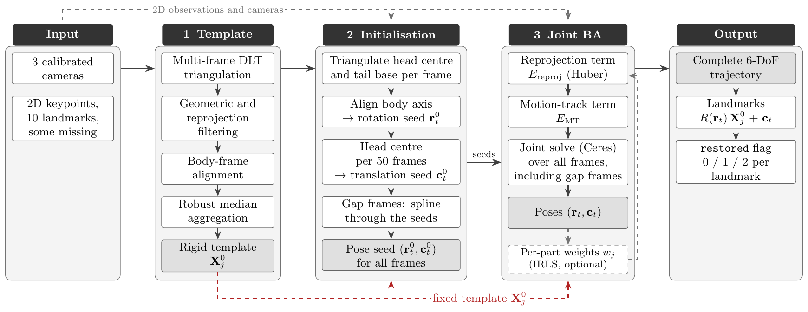

</div>

---

## Why this project

In real multi-camera recordings, the 2D keypoints that feed a 3D stage are degraded by **self-occlusion, pixel noise and missing frames, usually all at once**. Triangulating ten independent points per frame breaks down exactly when you need it most.

`BA_rigid` takes a different route. It treats the mouse as a **rigid body**:

1. Build a **rigid skeleton template** (10 landmarks) from multi-frame DLT triangulation.
2. Fit that template to **every frame as a single 6-DoF pose** with bundle adjustment. Every 2D observation from every camera constrains the same six unknowns, including frames where views are partly or fully missing.
3. Seed rotations from the **head to tail body axis**, so the optimiser never starts with head and tail swapped.
4. Add a **motion-track** term that predicts each pose from its temporal neighbours and compares both on a virtual grid attached to the template. This feeds temporal information to weakly observed frames.

Camera matrices and the template stay **fixed** during BA. The only unknowns are the per-frame poses.

## Highlights

| | |
|---|---|
| **Complete trajectory** | Every part in every frame is reconstructed (100% coverage). Per-frame DLT covers 97% / 78% / 49% of the points under Mild / Realistic / Severe degradation. |
| **Accuracy** | RMSE of **1.5 mm** (Mild), **3.3–3.6 mm** (Realistic) and **8.5–9.5 mm** (Severe), starting from an initial estimate that is about 118 mm off. |
| **Beats triangulation** | On the points DLT can reconstruct, the median error is **1.6–2.9× lower**. |
| **Motion-track helps where data is missing** | RMSE falls by **6.1%** (Realistic) and **10.8%** (Severe), by **41%** at 70% random occlusion, and by **50–55%** when all cameras lose frames at once. |
| **No divergence** | With motion-track no frame diverges in any of the nine compound cases. Without it, frames supported by a single view can blow up. |
| **Few knobs** | λ = 1 and a 16 mm grid spacing sit in a flat region (13–19 mm), so there is little to tune. |

<div align="center">
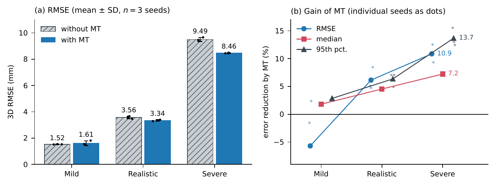
<br><sub><b>RMSE across degradation levels</b> (3 seeds). (a) accuracy with and without motion-track (MT). (b) the reduction MT achieves in RMSE, median and 95th percentile.</sub>
</div>

---

## How it works

### 1 · A rigid template from noisy triangulation

`generate_rigid_template` triangulates every part with linear DLT, filters samples by triangulation angle and adaptive MAD reprojection threshold, aligns each frame to a head-centred **body frame**, and aggregates each part with a robust median.

<div align="center">
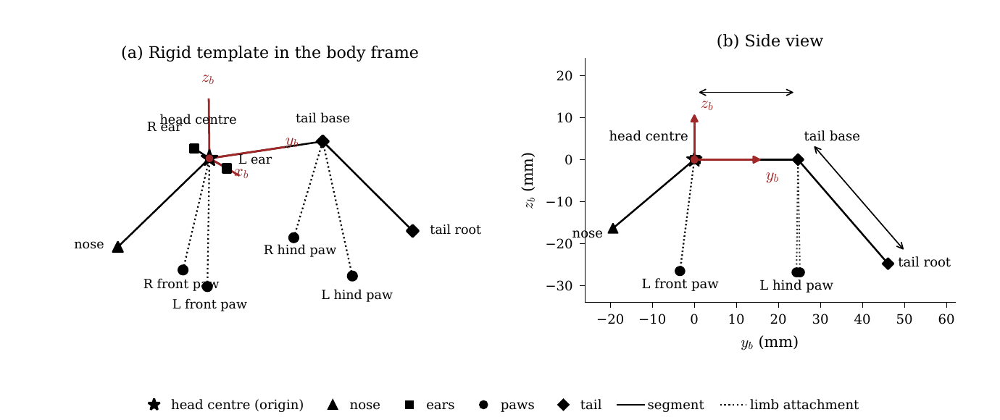
<br><sub><b>The rigid template</b> in the body frame: origin at the head centre, y-axis from head centre to tail base.</sub>
</div>

### 2 · Start in the right basin

A zero rotation can leave the optimiser with head and tail exchanged. Seeding each frame from the triangulated head-centre → tail-base axis lands it in the correct minimum.

<div align="center">
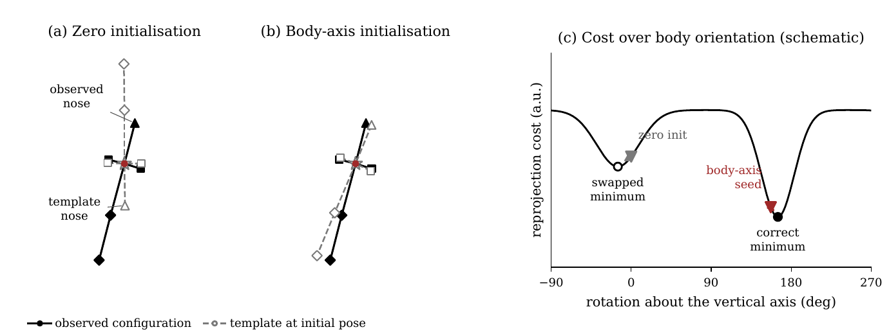
<br><sub><b>Why initialisation matters.</b> (a) zero rotation, (b) body-axis seed, (c) schematic cost over body orientation.</sub>
</div>

### 3 · Joint bundle adjustment with a motion-track term

All frames are solved together in one `ceres::Problem`:

- **Reprojection term** with a Huber loss over all available 2D observations.
- **Motion-track term** that predicts the pose at `t` from frames `t−2, t−1, t+1, t+2` by a four-point interpolation. It then compares the estimated and predicted poses on a virtual 3×3×3 grid (27 points) attached to the template.
- **Gap frames** with no observations at all are initialised by spline interpolation. They are constrained only by the motion-track term.

<div align="center">
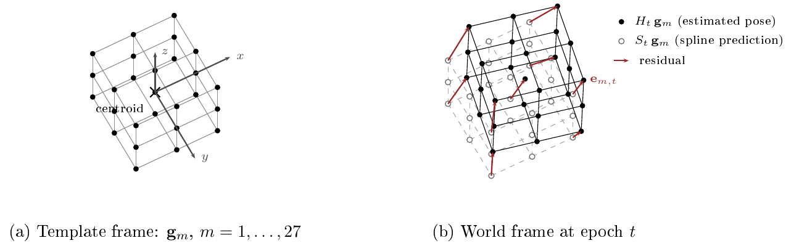
<br><sub><b>Motion-track.</b> Filled dots: grid under the estimated pose. Open circles: spline prediction. Red arrows: residuals.</sub>
</div>

---

## Results at a glance

All numbers come from one simulated sequence of **4,998 frames at 30 fps** with ten body parts and three calibrated cameras (front, side, top). Errors are 3D Euclidean distances to ground truth in millimetres. Each case uses three random seeds, and the template is re-estimated from each case's own degraded observations.

### The test sequence is deliberately hard

The animal reaches speeds of about 284 mm/s on average and changes direction 184 times, of which 106 are single-frame reversals of 147–180° ("flips") and 78 are smooth turns of up to 124°.

<div align="center">
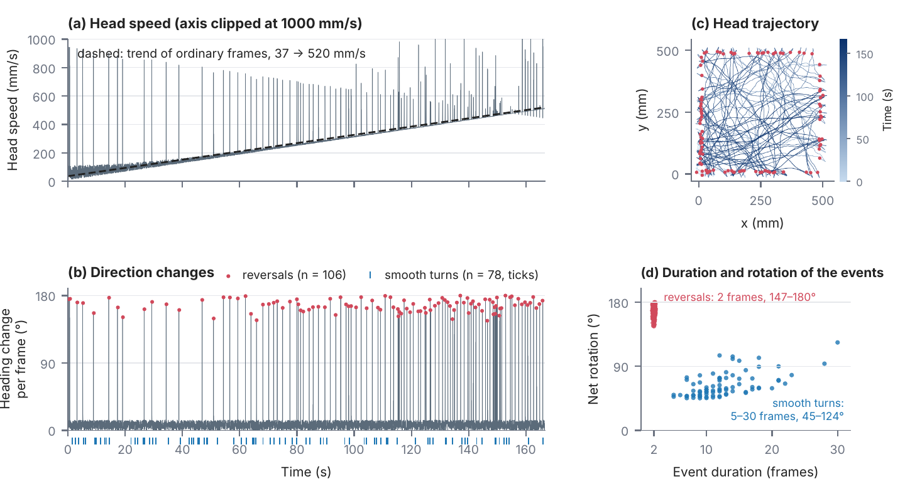
<br><sub><b>Ground-truth motion:</b> head speed, heading change, trajectory and event statistics.</sub>
</div>

### Degradation presets

Three compound scenarios combine camera blackouts, random occlusion and Gaussian pixel noise:

| | Mild | Realistic | Severe |
|---|:---:|:---:|:---:|
| Random occlusion | 10% | 30% | 50% |
| Pixel noise σ | 1 px | 2 px | 4 px |
| Blackouts per camera | 2 × 3 fr. | 5 × 5 fr. | 8 × 10 fr. |

<div align="center">
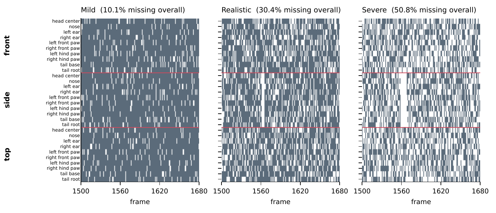
<br><sub><b>What the optimiser sees</b> (frames 1500–1680). Dark cells are observed; vertical gaps are camera blackouts.</sub>
</div>

### Accuracy (mean ± SD over 3 seeds, mm)

| Scenario | Method | RMSE | Median | 95th pct. |
|---|---|:---:|:---:|:---:|
| Mild | no-MT | 1.52 ± 0.01 | 1.34 | 2.44 |
| | MT | 1.61 ± 0.18 | 1.32 | 2.37 |
| Realistic | no-MT | 3.56 ± 0.10 | 2.94 | 5.02 |
| | **MT** | **3.34 ± 0.05** | **2.81** | **4.70** |
| Severe | no-MT | 9.49 ± 0.15 | 7.99 | 13.46 |
| | **MT** | **8.46 ± 0.03** | **7.41** | **11.62** |

RMSE excludes frames above 100 mm in either method (reported separately as divergent frames). Including them never reduces the advantage of MT; see the thesis for the threshold sweep from 30 to 500 mm.

### Where the motion constraint earns its keep

Each degradation was also applied on its own. The gain of MT grows with the amount of missing data. Pixel noise alone yields only 3–4%.

<div align="center">
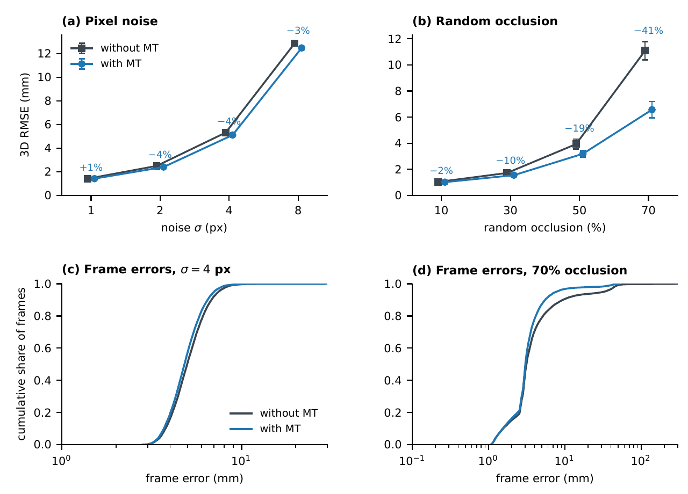
<br><sub><b>Pixel noise and random occlusion.</b> At 70% occlusion the RMSE falls from 11.1 to 6.6 mm.</sub>
</div>

<br>

<div align="center">
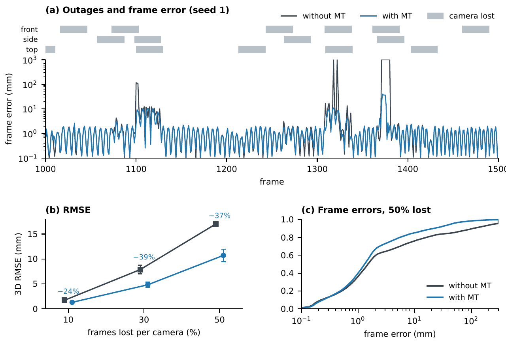
<br><sub><b>Per-camera blackouts.</b> The error spikes where two of three cameras are lost at once and only one view remains. MT stays near 10 mm while no-MT exceeds 100 mm.</sub>
</div>

<br>

<div align="center">
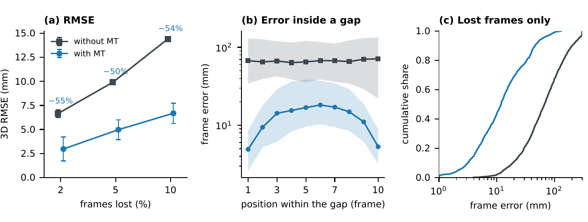
<br><sub><b>All cameras dark for 10 frames.</b> The median error inside the gap is 66.8 mm without MT and 11.9 mm with MT, the shape of an interpolation between the two observed ends.</sub>
</div>

| Condition | RMSE no-MT → MT | Change |
|---|:---:|:---:|
| Random occlusion 70% | 11.09 → 6.57 mm | −40.8% |
| Per-camera blackouts, 30% of frames | 7.87 → 4.83 mm | −38.7% |
| All-camera blackouts, 5% of frames | 9.90 → 4.98 mm | −49.7% |
| Pixel noise 4 px | 5.31 → 5.11 mm | −3.9% |

### It prevents divergence

When only a single camera sees a frame, the reprojection term leaves depth unconstrained. Without MT, such frames can diverge by orders of magnitude. With MT the same frames stay at the level of their neighbours.

<div align="center">
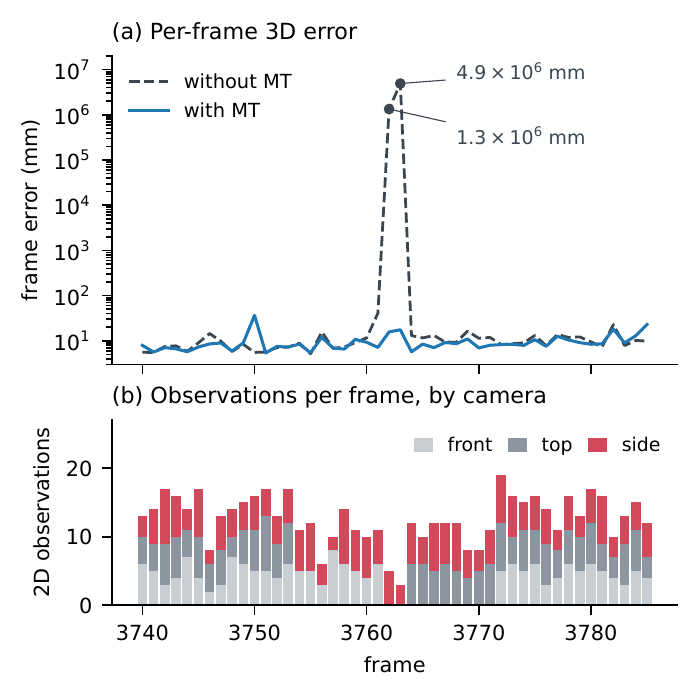
<br><sub><b>Severe scenario, seed 1.</b> Frames 3762 and 3763 diverge without MT. Both are seen by the side camera only.</sub>
</div>

### Robustness checks

<div align="center">
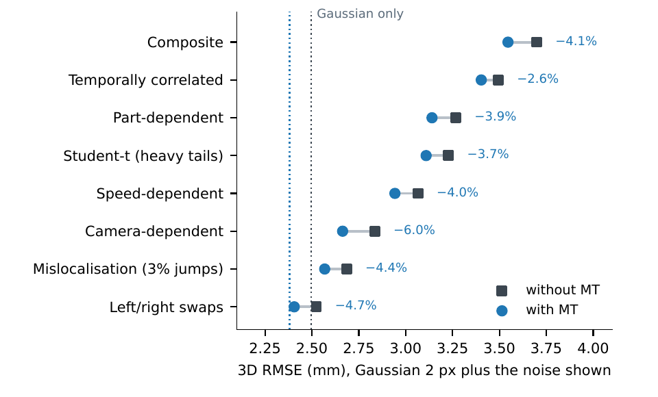
<br><sub><b>Eight realistic noise models</b> (heavy tails, mislocalisation, part- and camera-dependent, temporally correlated, speed-dependent, left/right swaps, composite). MT lowers the RMSE in all eight, by 2.6–6.0%.</sub>
</div>

<br>

<div align="center">
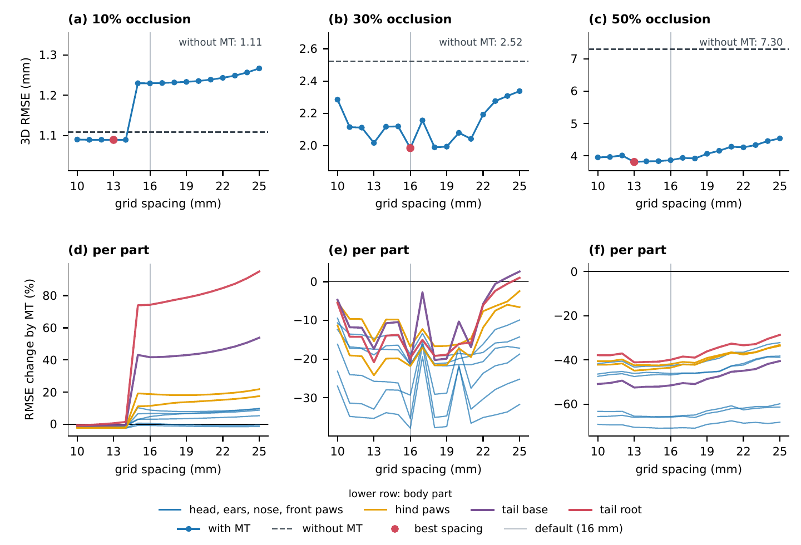
<br><sub><b>Grid spacing.</b> RMSE is flat for 13–19 mm. The default of 16 mm is within 0.06 mm of the best value at 50% occlusion.</sub>
</div>

### Known limit

Motion-track assumes smooth motion over five frames. Its operating boundary is the **abrupt reversal within a single frame** (the "flips", 4.2% of the frames). It follows smooth turns up to 124° as well as straight motion. Per-part IRLS weighting is implemented but gives no reliable gain, so it stays off by default.

---

## Quick start

### Requirements

- CMake ≥ 3.10 and a C++14 compiler
- [Ceres Solver](http://ceres-solver.org/)
- OpenCV with `core` and `calib3d`
- Python 3 with `numpy` and `matplotlib` (only for `plot_results.py`)

### Build

```bash
cmake -S . -B build
cmake --build build -j4
```

### Run

```bash
# 1. Build the rigid template from triangulated samples
./build/generate_rigid_template

# 2. Bundle adjustment, once without and once with motion-track
./build/BAmotiontrack --no-motion-track
./build/BAmotiontrack --motion-track --lambda 1 --grid-step 16

# 3. Evaluate against ground truth
./build/evaluation_3d --gt xyz_gt.csv

# 4. Plot
python plot_results.py --results_dir results --out_dir results/figures
```

Each tool prints its full option list with `--help`. Default inputs are resolved from the working directory, the executable directory and the source root.

> **Data.** The repository contains code only. Inputs are expected under `3cam/`: `cams.txt` (three 3×4 projection matrices) and `obs_de_{front,side,top}.csv`. The ground truth is `xyz_gt.csv`.

<details>
<summary><b>Input formats</b></summary>

**`cams.txt`**: the first three valid lines, each with 12 numbers (one 3×4 projection matrix). Blank lines and lines starting with `#` are ignored.

**Observation CSV** (one per camera), with column aliases accepted (`bodypart`, `u`/`v`, `time`/`timestamp`):

```csv
t,part,x,y
0.033333,nose,245.67,189.34
```

**Template CSV**: head-centred and body-axis aligned. A `head center` row at the origin is required.

```csv
part,X,Y,Z
nose,23.2,16.5,-2.0
```

**Ground truth** `xyz_gt.csv`: `frame,time,part,x_r,y_r,z_r` (`frame,t,part,X,Y,Z` is also accepted).

</details>

<details>
<summary><b>Output files</b></summary>

**`generate_rigid_template`**: `results/mouse_model_obj.csv`, plus an interactive Plotly view with the same basename and an `.html` extension.

**`BAmotiontrack`** (in `results/` or `--outdir`):

| File | Content |
|---|---|
| `pose_{no,with}_motion.csv` | `frame,t,rx,ry,rz,tx,ty,tz,motion_track`, one 6-DoF pose per frame |
| `xyz_restored_{no,with}_motion.csv` | `frame,t,part,X,Y,Z,restored,num_obs`, final 3D landmarks |
| `ba_summary_{no,with}_motion.csv` | solver summary |

The `restored` flag tells you how trustworthy a point is:

| Value | Meaning |
|:---:|---|
| `0` | All cameras observed this part |
| `1` | Fewer than all cameras; the pose is still supported by the other parts |
| `2` | Gap frame with no observations; pose comes from interpolation and motion-track |

**`evaluation_3d`**: GT-driven audit tables (`eval_3d_overall.csv`, `eval_3d_frame_audit.csv`, `eval_3d_part.csv`, `eval_3d_point_audit.csv`, `eval_3d_segment_audit.csv`) and plots such as RMSE over time, coverage, per-part RMSE and camera-missing heatmaps.

</details>

---

## Repository layout

```text
BA_rigid/
├── generate_rigid_template.cpp   # Stage 1: multi-frame DLT → rigid template
├── BAmotiontrack.cpp             # Stage 2: initialisation + joint BA (+ motion-track)
├── evaluation_3d.cpp             # Stage 3: GT-driven evaluation
├── plot_results.py               # plotting from the CSV outputs
├── CMakeLists.txt
└── docs/figures/                 # figures used in this README
```

## Scope and limitations

The evaluation uses **one simulated sequence** with planar motion (position and heading, no pitch or roll), a fixed three-camera layout and a fixed λ. The noise-model comparison uses one seed and assumed detector parameters. Natural next steps are out-of-plane rotation (with quaternion interpolation), other camera layouts, a comparison with post-hoc temporal filters, and real detector output.

## Background

Triggs et al., *Bundle Adjustment — A Modern Synthesis*, 1999. Joska et al., *AcinoSet: A 3D Pose Estimation Dataset and Baseline Models for Cheetahs in the Wild*, ICRA 2021.

---

<div align="center">
<sub>M.Sc. thesis project · Geodesy and Geoinformation Science · TU Berlin · Computer Vision &amp; Remote Sensing group</sub>
</div>
